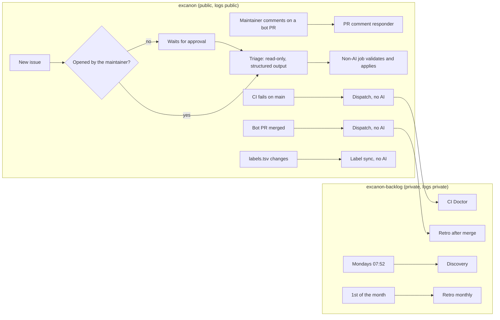

# Automation

Which agent flows run on their own, where they run, and what they can touch. Every flow ends at a maintainer gate: nothing here merges, tags, publishes or approves.

## What runs where

Flows that read the private backlog run in `excanon-backlog`, because Actions logs on a public repository are public.

| Flow | Trigger | Runs in | Claude can |
|---|---|---|---|
| PR comment responder | The maintainer comments on a PR opened by `excanon-bot` | excanon | Read and write excanon through the bot. Rules come from `main`; the PR is checked out into `./pr-head`. |
| Triage | An issue is opened (waits for approval unless the maintainer opened it) | excanon | Read only. Its output is validated and applied by a separate, non-AI job. |
| CI Doctor | CI fails on a push to `main` | backlog | Read excanon's logs, and write backlog tickets |
| Discovery | Mondays at 07:52 Bogota, or by hand | backlog | Read excanon, and write backlog tickets and reports |
| Retro | A bot PR is merged; the 1st of each month; or by hand | backlog | Write backlog notes, and open PRs to excanon's `.agents/` |
| Label sync | `labels.tsv` changes on `main` | excanon | No AI. Updates the backlog's labels. |

## Safety properties

- **Who can trigger:** only the maintainer, the schedule, or an approved run. The action also refuses users without write access, except in triage, where every run first waits for the maintainer's approval in the `agent-external` environment.
- **Untrusted input:** triage gets a read-only token and a restricted tool list. Its output must pass allowlists (labels, stages, reply length) before a non-AI job applies it, and @mentions are neutralized.
- **Rules can't be swapped by a PR:** the PR responder reads `AGENTS.md` and `.agents/` from `main`, never from the PR branch.
- **The bot has no Workflows permission,** so no agent can edit these files. Changes to automation always come from a maintainer-approved PR.
- **Embargoed findings** from automated runs go only to private backlog issues labeled `embargoed`. See the backlog protocol.
- **Approval expiry:** runs waiting for approval expire after GitHub's default of 30 days.

## One-time setup (maintainer)

In **both** `excanon` and `excanon-backlog`, under **Settings → Secrets and variables → Actions**:

| Kind | Name | Value |
|---|---|---|
| Variable | `EXCANON_BOT_CLIENT_ID` | The bot App's **Client ID**, from its settings page |
| Secret | `EXCANON_BOT_PRIVATE_KEY` | The bot's private key, already set in excanon; add it to the backlog too |
| Secret | `CLAUDE_CODE_OAUTH_TOKEN` | The output of `claude setup-token`, run locally. Uses your Claude plan. |

In `excanon`, under **Settings → Environments → New environment**:

1. Name it `agent-external`.
2. Under **Required reviewers**, add `jmalovera10`.

Finally, copy the workflows from `.agents/automation/backlog-workflows/` into `excanon-backlog/.github/workflows/`, or let an agent open that PR if it has access to the backlog repository.

## Testing a flow

Each backlog workflow can be started by hand from its **Actions** tab (**Run workflow**). Run discovery once by hand before trusting the schedule.
