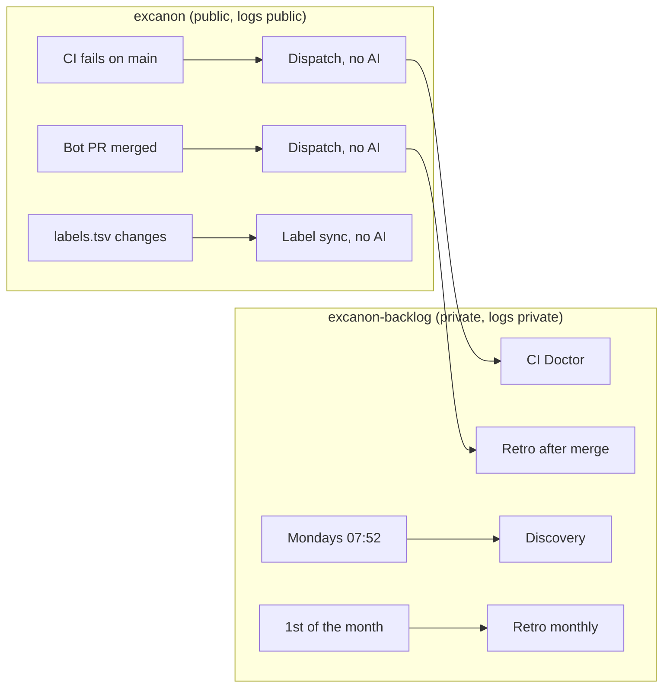

# Automation

Which agent flows run on their own, where they run, and what they can touch. Every flow ends at a maintainer gate: nothing here merges, tags, publishes or approves.

**Public issues and PR comments are never input to an automated run.** They're handled locally, under the maintainer's supervision, with `/triage` and `/pr-comments`. Automated runs still read some untrusted text, namely web pages and the quoted blocks in `from:triage` tickets, so they are built to contain it: an agent that is misled has no secret it can read and no public place it can write to.

## What runs where

Every AI flow runs in `excanon-backlog`, because Actions logs on a public repository are public. The public repository only runs small non-AI workflows that forward events.

## What each automated run can do

Each run has three parts. Non-AI steps run before the agent and save what it needs to `.agent-input/`. The agent works with the limits below. Non-AI steps after the agent publish its output, where a flow has any.

| Flow | Trigger | Before the agent (no AI) | The agent can | After the agent (no AI) |
|---|---|---|---|---|
| CI Doctor | CI fails on a push to `main` | Saves the failed log and run details; checks out the failing commit | Read the checkout; run `mix` checks and tests and read-only `git`; write backlog issues | Nothing |
| Discovery | Mondays at 07:52 Bogota, or by hand | Runs the code-health commands and saves each output | Read the checkout; search the web; fetch allowlisted domains; write backlog issues | Nothing |
| Retro | A bot PR is merged; the 1st of each month; or by hand | Saves the maintainer's PR feedback, filtered to the maintainer | Read and edit the checkout; write backlog issues | Checks that only `.agents/` (not `policy/`) changed, regenerates adapters, commits, and opens a PR |
| Label sync | `labels.tsv` changes on `main` | | No AI. Updates the backlog's labels. | |

Limits that apply to every agent, subagents included:

- **Tokens.** The agent's GitHub token can only write issues in the private backlog. A token that can write to excanon is created only after the agent has finished, and only for Retro's publishing step.
- **Files.** Reads and edits are limited to the working directory, a fresh checkout with no stored credentials. The agent can't read the process environment, where the Claude token lives.
- **Commands.** Only the commands listed in each workflow's `--allowedTools` run. Anything else is denied, including commands nested inside an allowed one.
- **Web.** CI Doctor and Retro have no web access. Discovery can search, and can fetch only these domains: `github.com`, `raw.githubusercontent.com`, `hex.pm`, `hexdocs.pm`, `elixir-lang.org`, `www.erlang.org`, `jsonlogic.com`, `gorules.io`, `docs.gorules.io`, `microsoft.github.io`, `www.drools.org`, `docs.drools.org`, `cel.dev`, `www.openpolicyagent.org`, `www.npmjs.com`, `pypi.org`, `pkg.go.dev`. Additions are a maintainer change to the backlog workflow.

These limits rely on how Claude Code enforces permissions when no one is there to approve. That behavior was measured with Claude Code 2.1.305 before adopting this design:
- a tool that isn't listed is denied,
- a read outside the working directory is denied,
- `$(…)` inside an allowed command is blocked,
- a fetch outside the domain list is denied,
- subagents inherit all of these limits.

Two details matter when changing these workflows (both measured):
- **Never list a bare `Read`, `Edit` or `Write`.** Doing so removes the directory limit. The workflows scope `Read` and `Edit` to `./**` instead.
- **Use `Edit` rules for file paths.** Path rules match only `Read` and `Edit`, and an `Edit` rule covers every file-writing tool. A `Write(...)` rule is silently ignored.

## Local, supervised flows

| Command | Use | Supervision |
|---|---|---|
| `/triage <issue>` | Classify a public issue, reproduce bugs, propose labels, a reply and backlog tickets | Nothing is labeled, posted or recorded until the maintainer confirms. Reproductions built from an issue run only after the maintainer approves them. |
| `/pr-comments <PR> [comment]` | Work through the maintainer's review comments | Changes are committed locally and replies drafted. Nothing is pushed or posted until the maintainer confirms. |

The monthly performance study also runs only in a session the maintainer starts, because it needs to run arbitrary commands and install other engines.

## Safety properties

- **Who can trigger:** only the maintainer, a push or merge to `main`, or the schedule. No automated run starts from an issue, a comment, or a pull request from someone else.
- **Untrusted input:** public issues and comments reach agents only in local runs the maintainer supervises. When triage records them in the backlog, they're quoted in a block marked as untrusted, and agents read that block as data.
- **Rules from issues are code:** the `call` operation runs the file it names, so reproductions refuse it and run only with the maintainer's approval.
- **The bot has no Workflows permission,** so no agent can edit these files. Changes to automation always come from a maintainer-approved PR.
- **Embargoed findings** from automated runs go only to private backlog issues labeled `embargoed`. See the backlog protocol.
