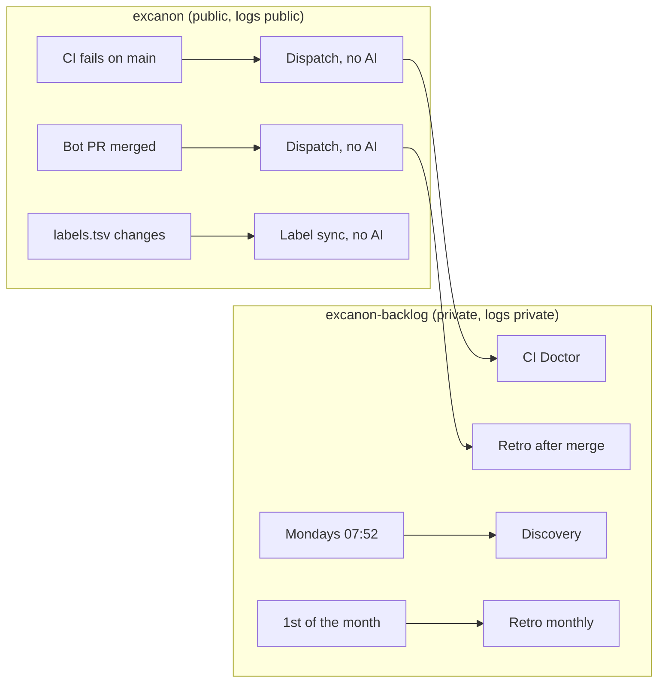

# Automation

Which agent flows run on their own, where they run, and what they can touch. Every flow ends at a maintainer gate: nothing here merges, tags, publishes or approves.

**No automated flow reads input from outside the project.** Public issues and PR review comments are handled locally, under the maintainer's supervision, with `/triage` and `/pr-comments`. Automated runs never respond to them.

## What runs where

Every AI flow runs in `excanon-backlog`, because Actions logs on a public repository are public. The public repository only runs small non-AI workflows that forward events.

| Flow | Trigger | Runs in | Claude can |
|---|---|---|---|
| CI Doctor | CI fails on a push to `main` | backlog | Read excanon's logs, and write backlog tickets |
| Discovery | Mondays at 07:52 Bogota, or by hand | backlog | Read excanon, and write backlog tickets and reports |
| Retro | A bot PR is merged; the 1st of each month; or by hand | backlog | Write backlog notes, and open PRs to excanon's `.agents/` |
| Label sync | `labels.tsv` changes on `main` | excanon | No AI. Updates the backlog's labels. |

## Local, supervised flows

| Command | Use | Supervision |
|---|---|---|
| `/triage <issue>` | Classify a public issue, reproduce bugs, propose labels, a reply and backlog tickets | Nothing is labeled, posted or recorded until the maintainer confirms |
| `/pr-comments <PR> [comment]` | Work through the maintainer's review comments | Changes are committed locally and replies drafted; nothing is pushed or posted until the maintainer confirms |

## Safety properties

- **Who can trigger:** only the maintainer, a push or merge to `main`, or the schedule. No automated run starts from an issue, a comment, or a pull request from someone else.
- **Untrusted input:** public text only reaches agents in local runs the maintainer supervises. When triage records it in the backlog, it's quoted in a block marked as untrusted, and agents read that block as data.
- **The bot has no Workflows permission,** so no agent can edit these files. Changes to automation always come from a maintainer-approved PR.
- **Embargoed findings** from automated runs go only to private backlog issues labeled `embargoed`. See the backlog protocol.
