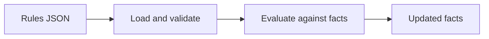

<!--
Technical spec, written by the Architect from a prioritized proposal and posted
on the backlog ticket. Fill in every section, or write "n/a: <reason>".

The maintainer reads this to decide. Lead with diagrams and plain language:
a reader who doesn't know excanon's internals should understand the change from
the summary and diagrams alone. Explain any technical term the first time it
appears, or replace it with a plain description.
-->

## Spec: <ticket title>

**Proposal:** <link> · **Impact:** <trivial | standard | high>, triggers <numbers or none> · **Version bump:** <none | patch | minor | major>

### In plain words

Three to five sentences, no jargon: what changes for someone using excanon, and why.

### Diagrams

Use Mermaid code blocks, which GitHub renders in tickets and docs. Give each diagram a one-sentence caption saying what to notice in it. Include every diagram that applies:

| Diagram | When it's required | Mermaid type |
|---|---|---|
| **Before and after** | Always: how the relevant part of excanon works today, and after the change | `flowchart` |
| **Flow** | The change affects how rules are loaded or evaluated, or the order of steps | `sequenceDiagram` or `flowchart` |
| **Structure** | Modules, processes or data structures are added, removed or change responsibilities | `flowchart` or `classDiagram` |
| **States** | Something moves between states, such as rule loading or engine lifecycle | `stateDiagram-v2` |

Keep each diagram small, ideally under 12 boxes. Label boxes with what they do ("checks rule order"), not only module names. Split a large picture into several focused diagrams.

### Behavior

The externally visible behavior, precise enough to write tests from. Include the rule JSON, the facts, and the exact result or error for:
- the main case,
- every edge case: empty and `nil` inputs, wrong types, deep nesting, large inputs, interaction with `after` and `requires`.

### Public contract changes

What changes in the contract defined in `.agents/policy/versioning.md`: modules, functions, `@spec`s, the rule format, semantics, result shapes. Write "none" if nothing does.

### Design

- **Data shape:** the structures involved, and how they're represented.
- **Modules touched,** and the responsibility each one gets.
- **Alternatives considered,** and why each was rejected. For high-impact specs, link the arena results.

### Compatibility and migration

What existing users see. For any deprecation or breaking change: the deprecation step, the migration note, and the release it lands in.

### Performance

The expected effect on evaluation cost, and whether the Performance Engineer must measure it.

### Decision record

Does this need an ADR in `docs/adr/`? If yes, give its title and the one-paragraph decision. The Developer commits it with the implementation.

### Open questions

Questions for the maintainer that the spec can't settle.
